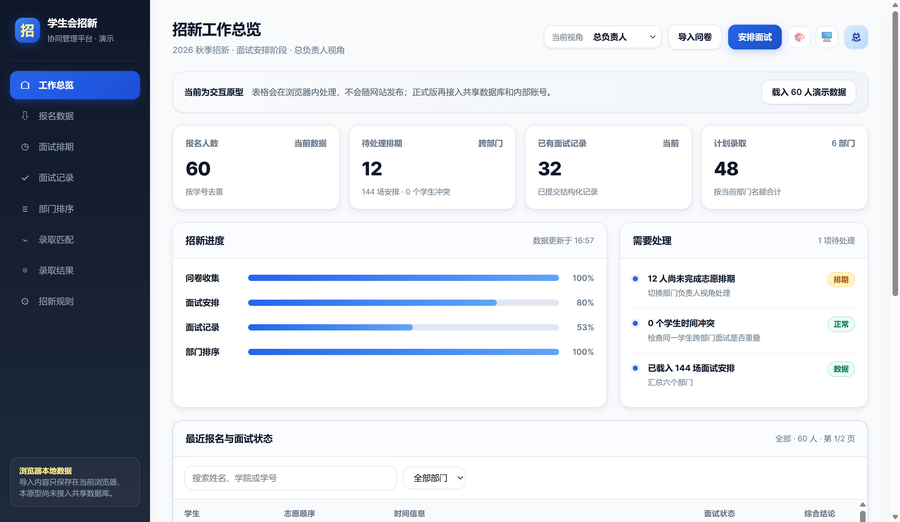
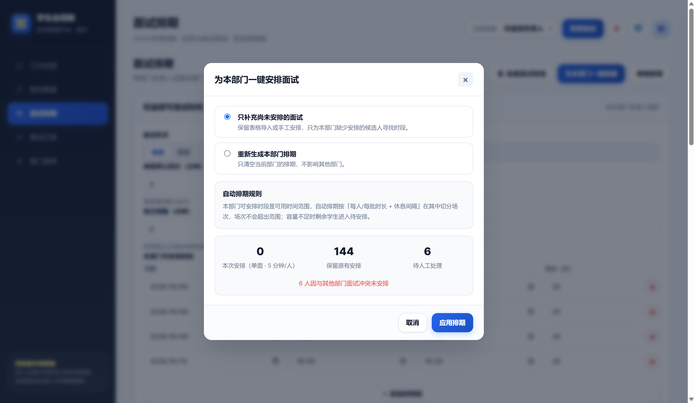
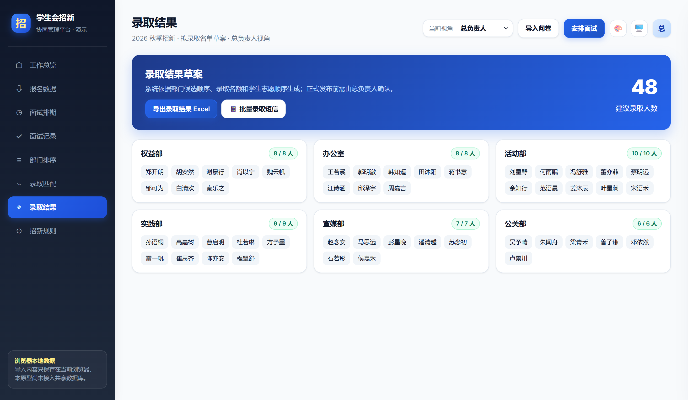

# 学生会招新协同平台


面向学生会总负责人和各部门负责人的招新管理系统，覆盖报名导入、面试排期、面试评价、部门排序、三志愿录取匹配和结果导出。

当前版本用于负责人内部协作。报名信息通过 Excel、CSV 等文件导入，不提供学生在线报名入口。

## 当前展示版本

当前展示基线：**20261017**。本版用于展示现有招新流程，后续权限增强版将单独开发和保留。

已核对 `dist/` 与 `server/` 的12个文件，均与本地冻结展示基线逐字节一致。功能代码基准提交：[`c3666c3`](https://github.com/ClayAllan/student-union-recruitment/commit/c3666c32b93c2338c73848b223f6a491d5bb5db7)。

版本范围和下载方式见[版本说明](docs/版本说明.md)，文件校验记录见[展示基线清单](versions/demo-20261017.json)。

## 在线体验

[打开在线演示](https://clayallan.github.io/student-union-recruitment/)

演示版内置60名虚构报名者，可体验部门视角、面试排期、评价和录取匹配。修改仅保存在当前浏览器，不连接正式共享数据库；请勿导入真实个人信息。

首次发布需在仓库 Settings → Pages 中将 Source 设为 GitHub Actions，再运行 Deploy public demo。以后更新前端时会自动重新发布。

## 从哪里开始

| 你的目的 | 查看内容 |
| --- | --- |
| 了解系统功能 | 阅读下方“主要功能”和页面预览 |
| 开展报名、面试与录取工作 | [负责人使用指南](docs/使用指南.md) |
| 安装多人协作版 | [部署与验收说明](20261017_协作版部署与验收说明.md) |
| 排查使用问题 | [常见问题](docs/常见问题.md) |
| 获取报名模板 | [Excel标准模板](dist/student-union-recruitment-template.xlsx) |

静态演示的数据保存在当前浏览器；负责人协作版需要运行后端，通过账号访问服务器中的共享数据。

## 页面预览

以下截图使用虚构演示数据。

### 工作总览



### 面试排期



### 录取结果



## 主要功能

- **报名管理**：导入现有报名表或标准模板，管理学生信息、部门志愿和可面试时间，支持搜索与状态筛选。
- **面试排期**：配置部门可用时段，支持单面、群面、自定义时长、场次间隔、自动排期及跨部门时间冲突检查。
- **面试评价**：按场次查看学生，填写和修改本部门的评价、评分与结论。
- **部门排序**：调整候选人顺序，支持上下移动和指定名次交换。
- **录取匹配**：按志愿顺序、部门排序及名额生成建议名单，支持调剂配置和结果导出。
- **通知文案**：使用模板批量生成面试、调期和录取通知，可复制或导出发送清单；暂未接入实际短信发送服务。
- **负责人协作**：提供账号登录、共享数据、部门权限、定时同步及保存冲突提示。
- **数据维护**：提供操作记录、数据库备份脚本及每日定时备份配置。

## 录取规则

1. 按第一、第二、第三志愿依次处理。
2. 各部门按候选人排序录取，达到名额上限后停止。
3. 每位学生只能被一个部门录取。
4. 排除对应部门评价为“不建议”的学生。
5. 根据配置决定是否进行自动调剂。

系统生成的是建议录取结果，正式发布前仍需负责人审核。

## 技术方案

| 部分 | 实现 |
| --- | --- |
| 前端 | HTML、CSS、JavaScript |
| Excel 导入导出 | SheetJS |
| 后端 | Python 3.10 及以上，仅使用标准库 |
| 数据库 | SQLite |
| 生产部署 | Ubuntu、Nginx、systemd |
| 数据同步 | 定时获取更新，保存时检查数据版本 |

部门权限由服务端校验。并发保存发生版本冲突时，系统会拒绝旧版本覆盖，并提示保留草稿、刷新后重新操作；当前不自动合并冲突。

## 项目目录

```text
.
├── README.md
├── .gitignore
├── docs/
│   ├── 使用指南.md
│   ├── 常见问题.md
│   └── images/
│       ├── dashboard.png
│       ├── scheduling.png
│       └── results.png
├── dist/
│   ├── index.html
│   ├── collaboration.js
│   ├── xlsx.full.min.js
│   └── student-union-recruitment-template.xlsx
├── server/
│   ├── app.py
│   ├── backup.py
│   ├── install.sh
│   ├── nginx.conf.template
│   ├── recruitment.service
│   ├── recruitment-backup.service
│   ├── recruitment-backup.timer
│   └── test_service.py
├── scripts/
│   └── generate-template.cjs
└── 20261017_协作版部署与验收说明.md
```

## 运行与部署

### 静态演示

通过静态网页服务访问 `dist/`，可以体验浏览器本地存储版本。不同浏览器之间的数据不会共享。

### 负责人协作版

协作版需要运行 Python 后端，并由 Nginx 转发访问。仅上传前端文件，不能启用共享数据库和账号权限。

推荐部署方式：

1. 将完整程序上传到 Ubuntu 服务器。
2. 在发布目录执行 `sudo bash server/install.sh`。
3. 创建总负责人和部门负责人账号。
4. 配置域名解析、Nginx 和 HTTPS。
5. 验证登录、权限、同步、冲突处理及自动备份。

后端默认仅监听 `127.0.0.1:8787`，不需要向公网开放该端口。公网登录默认要求 HTTPS。

完整步骤见 [协作版部署与验收说明](20261017_协作版部署与验收说明.md)。

## 数据与备份

- 数据库应保存在网站目录和源码仓库之外。
- 初次安装的共享数据库为空，不会自动读取原浏览器中的数据。
- 原有数据需由总负责人通过报名表或系统支持的 JSON 备份恢复功能导入。
- 安装脚本提供每日备份配置，默认保留本机最近 14 天的备份。
- 同机备份无法应对整台服务器丢失或试用到期回收，应另行保存所需备份。
- 真实报名信息、联系方式、数据库、账号密码和密钥不得提交到 GitHub。

## 当前状态

当前展示基线已完成本地开发与流程测试，包含报名筛选、排期、评价、录取、账号权限、数据同步和冲突保护。

腾讯云协作环境已由使用者验证账号登录、部门可见范围、备注跨账号同步、HTTPS、证书模拟续期及数据库备份。线上排期、评价、排序和录取导出仍需继续逐项验收。

网页账号管理、四级个人岗位、多面试官独立评价和通知任务授权属于待确认的权限增强版，尚未在本展示基线实现。
